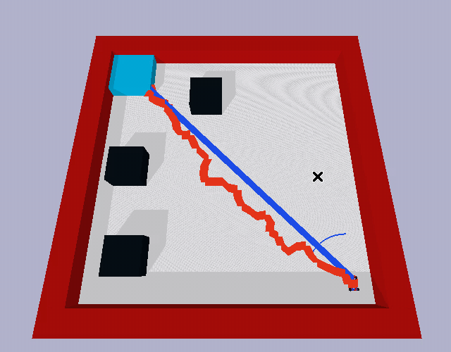
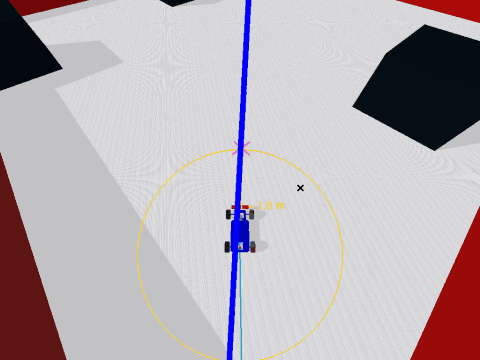
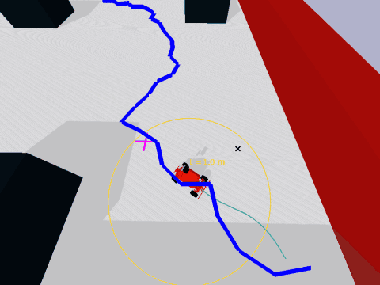

# Robot Proving Grounds: Planning Demos in Docker



*The Race demo with the lookahead slider being changed live. Each circle has radius L, and the cars follow their planned paths with Pure Pursuit.*

### F1TENTH: A* + Pure Pursuit



*The yellow circle has radius L. The magenta cross is the waypoint Pure Pursuit is aiming at, and the teal line is the route the car has driven. L is changed while it runs.*

### MuSHR: RRT + Pure Pursuit



*The same overlays on the MuSHR car following a jagged RRT path. A larger L cuts corners and smooths the ride, and a smaller L hugs the path.*

This page is here for public viewing for the **Existential Robotics Planning Workshop on 29 October 2026**. It explains how to run the workshop's PyBullet planning demos on your own laptop with Docker. The demo source itself lives in the Existential Robotics lab's repository, so this repo only holds these install instructions.

The simulator window shows up in your browser. You do not need to install PyBullet, conda or anything graphical, and you do not need to clone any repository. The only thing you need is Docker.

## Device compatibility

| Platform | Supported | Notes |
|---|---|---|
| Apple Silicon Mac (M1/M2/M3/M4) | Yes | Native arm64 image, nothing is compiled on your machine. |
| Intel Mac | Yes | |
| Linux (x86_64 or arm64) | Yes | |
| Windows | Yes | Requires Docker Desktop with the WSL2 backend. |

Your graphics card is never used. PyBullet's GUI renders against a virtual display with software rendering (Mesa llvmpipe) inside the container, then streams to your browser. So the only thing that determines compatibility is whether Docker can run on your machine, not your GPU or display drivers.

## Quick start

1. Install [Docker Desktop](https://www.docker.com/products/docker-desktop/) and start it.
2. Open a terminal (PowerShell on Windows, Terminal on Mac) and run the prebuilt image. It downloads on first use (about 1 GB), so please do this on good wifi **before** the workshop:

   ```bash
   docker run --rm -p 6080:6080 -p 6081:6081 ghcr.io/dhruvdotc/rpg-demo:latest
   ```

3. Open http://localhost:6081 in your browser.

The page has a list of demos on the left and the simulator on the right. Click any button to start that demo. Clicking another one stops the current run and starts the new one.

## Using the page

- **Lookahead slider (L).** Drag it while a demo runs to change Pure Pursuit's lookahead distance live, from 0.3 to 4.0 m. The P controller has no lookahead, so the slider does not change how it drives.
- **Speed slider.** Changes every car's wheel speed live, from 3 to 30. The default of 13 is the original speed, and both controllers use it. Very high speeds can make a car overshoot turns, which is a good way to see why L matters.
- **Circle and label.** Each car has a circle of radius L around it, with an "L = ... m" label. Pure Pursuit aims at the first point on the path that lies beyond the circle.
- **Target marker.** A cross shows the waypoint the controller is aiming at right now.
- **Trail.** The route the car has actually driven is drawn behind it, so you can compare it with the planned path.
- **Live stats.** The side panel shows elapsed time, how far the car is from the planned path, and the steering angle. In the Race demo, A* and RRT each get their own line.
- **Finish summary.** When a car reaches the goal, its panel shows the finish time and the mean and maximum distance from the path. The scene stays on screen until you start another demo.
- **Restart.** "Restart this demo" runs the same planner and controller again on a new random layout.

Try a small L (0.5) and a large one (3.0), at a slow and a fast speed, and compare the trail and the deviation numbers.

## What you can run

- Race demo: A* and RRT routes raced side by side, with either the Pure Pursuit or the P controller.
- F1TENTH demo: A* or RRT, each with Pure Pursuit or the P controller.
- MuSHR demo: A* or RRT, each with Pure Pursuit or the P controller.

## Running one demo directly

If you would rather skip the launcher page, pass a command to `docker run`. The viewer is then at http://localhost:6080/vnc.html.

```bash
docker run --rm -p 6080:6080 ghcr.io/dhruvdotc/rpg-demo:latest \
    python demo/f1tenth_demo.py --planner rrt --controller p
```

## Things to know

- Rendering is done in software inside the container, so the frame rate can be lower than a native window, especially on a laptop.
- In Docker Desktop, give the container at least 2 GB of memory.
- Stop everything with Ctrl+C in the terminal where you ran `docker run`.
- If you see `denied` or `unauthorized` when pulling the image, tell a workshop organizer.
